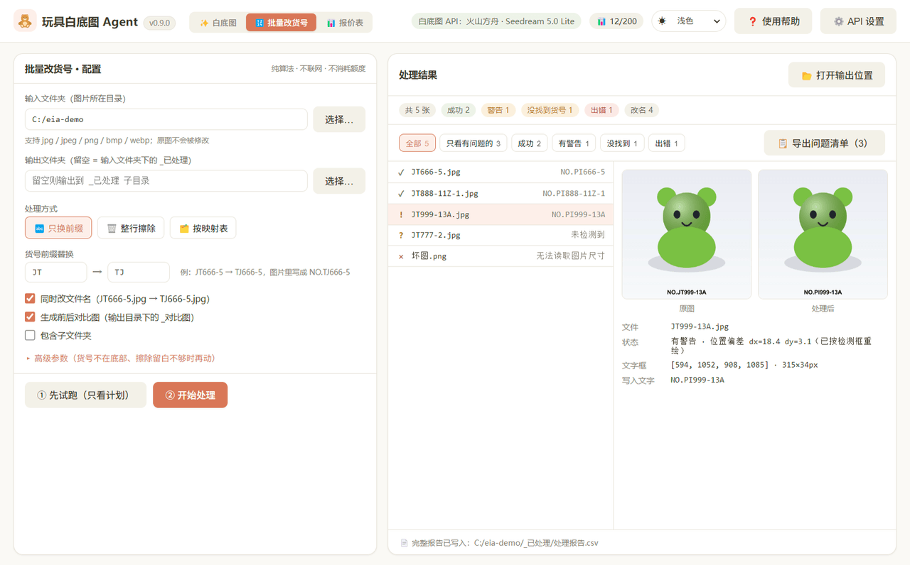
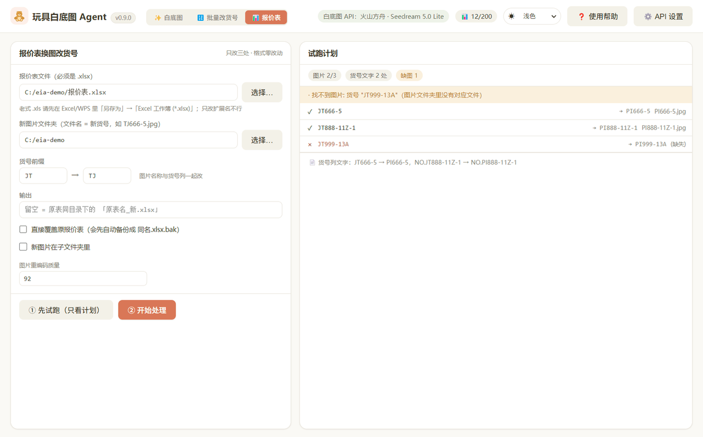
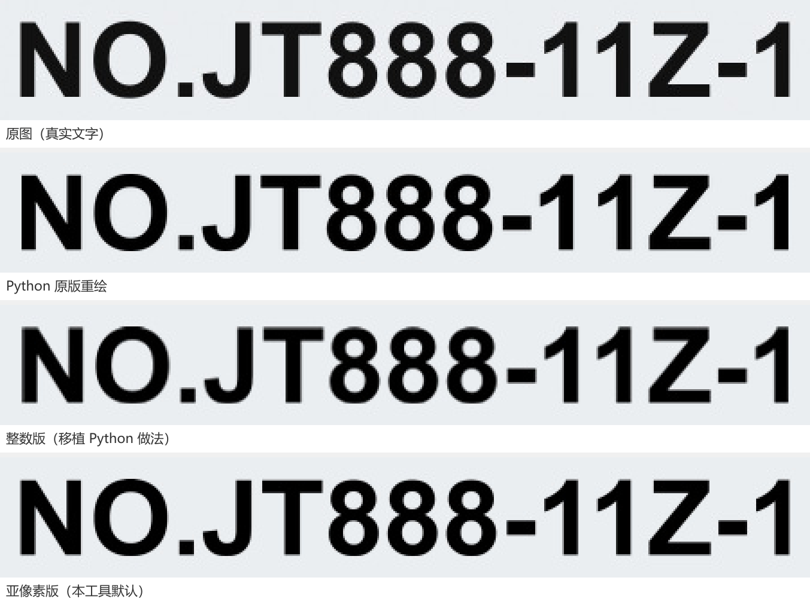

# 🧸 玩具白底图 Agent（Ecommerce Image Agent）

> 面向电商的桌面应用：上传玩具产品图，把背景替换为纯白底图，支持 **AI 生成** 与 **纯算法抠白底（免费）** 两种方式，支持**批量处理**、前后对比、多种比例与深色模式。
> 另含两条**全免费流水线**：**批量改货号**（整目录几何定位 → 擦除 → Arial Bold 重绘，可同时改文件名）与**报价表换图改货号**（.xlsx 格式零改动）。
> 内置主流生图模型预设（火山方舟 / OpenAI / 智谱 / 硅基流动 / 阿里百炼），本地额度统计与结果缓存管理。


主界面（浅色 / 深色）—— 上传玩具产品图，右侧实时看到抠白底前后的对比：

| 浅色 | 深色 |
| --- | --- |
|  |  |

两条免费流水线：

| 批量改货号（整目录） | 报价表换图改货号（.xlsx） |
| --- | --- |
|  |  |

<sub>以上截图由 `npm run ui:shot` 从**真实构建产物**生成（`scripts/ui-shot.cjs`），不是拼图；
演示用的产品图也是脚本现场合成的，仓库里不放二进制素材。</sub>

## 功能亮点

- 🖼️ **批量改图**：一次上传多张（多选 / 拖拽），顺序批量生成，逐张显示状态（待处理 / 处理中 / 成功 / 失败可重试）；**运行中清空/删除列表即中止**剩余付费调用，不会白扣费
- 🔄 **重新生成**：修改 API 参数（提示词 / 比例等）后一键重跑当前图片，无需重新上传
- 🔍 **前后对比**：并排 / 滑动两种对比模式
- ⚡ **主流模型预设**：5 大服务商一键填充（火山方舟 Seedream 5.0 Lite/Pro / OpenAI gpt-image-2 / 智谱 GLM-Image / 硅基流动 Qwen-Image / 阿里百炼 DashScope 原生），也支持任意 OpenAI 兼容服务手动配置
- 🧹 **纯算法抠白底（免费）**：不依赖任何 API，本地像素算法（多色背景建模 + 泛洪填充 + 边缘去污染）秒级抠白底，保留产品真实细节；与 AI 生成两条路径并行，按需切换
- 📐 **无损画布扩展（免费）**：纯算法把原图放到目标比例画布（1:1 / 4:3 / 16:9 等），原图**像素级不变**、四周补纯白边；支持「保持原图大小」与「等比缩放适配」两种放置策略，批量秒级完成——电商上架常用比例一步到位
- 📏 **多比例输出**：1:1、16:9、9:16、4:3、3:4、2:3、3:2、21:9（自动换算为模型支持的 size 档位，如 16:9 → 2560x1440），或自定义像素 `size`（支持 `*` / `×` 自动转 `x`；需 ≥ 3686400 像素）
- 🔀 **三种请求风格**：`images/generations`（方舟 / OpenAI / 智谱 / 硅基流动等）、`images/edits`（multipart）、`chat/completions`（多模态 OpenAI 兼容服务）
- 📖 **应用内使用帮助**：右上角「❓ 使用帮助」内置完整说明书，左侧目录点击跳转对应章节，随时查看
- 🌓 **深色模式**：跟随系统 / 浅色 / 深色三档，原生控件 `color-scheme` 适配
- 🎨 **Claude 风格 UI**：暖米色 + 陶土橙配色，浅色 / 深色双主题
- 📊 **额度统计**：本地每月额度上限与已用张数统计，超限自动拦截，跨月重置
- 💰 **余额查询**：OpenAI 官方 / 支持 billing 端点的兼容服务可一键查询账户余额
- 💧 **AI 水印开关**：显式控制生成图的可见 AI 水印（`watermark` 参数）
- 🧹 **缓存管理**：启动自动清理 7 天前的结果图片，设置面板可视化显示占用并可一键清理
- 🔤 **内置 emoji 字体**：打包 Noto Color Emoji，精简版/字体缺失的 Windows 系统上图标也不会变方块
- 🔢 **批量改货号（免费）**：整个文件夹一次处理 —— 底部几何投影定位货号行 → 擦除 → Arial Bold 重绘新货号，可同时改文件名（`JT666-5.jpg` → `TJ666-5.jpg`）；支持「只换前缀 / 整行擦除 / 按映射表」三种方式，输出前后对比图与 CSV 报告。**不联网、不调用任何模型、不消耗额度**
  - **精度对照**（`tests/labelParity.test.ts`，拿仓库里的 Python 原版当裁判）：检测框误差 **≤ 1px**；浅灰渐变底 + 噪点样图上，与原版输出的**整图平均像素差 0.039~0.137 / 255**，差异仅落在字形抗锯齿边缘
  - **亚像素定位**（默认开启）：整数字框带 ±1px 量化误差（30px 高的字上就是 3% 字号误差），改用灰度覆盖率反推连续边界，精度到 **±0.05px**；字形按 4 倍超采样栅格化到亚像素尺寸与位置
    - 用「同字重绘」当幂等测试、与原图上的真实文字比对：**本工具平均 IoU 0.911 / 像素差 1.248，Python 原版 0.890 / 1.543** —— 重绘这一步已优于原版（`subpixel: false` 可退回整数路径与原版对齐）
  - 擦除填色取**外框四周一圈的中位数**（不写死白色）；可自定义字体族（中文货号需指定中文字体）
  - 结果页带**按状态筛选**（全部 / 只看有问题的 / 成功 / 有警告 / 没找到 / 出错，按钮上带计数），可一键导出**问题清单 CSV** 便于逐张排查
    - **字体不再依赖系统**：随应用打包 `Liberation Sans Bold`（SIL OFL 1.1，实测与 Arial Bold **度量完全一致**，多组字符串宽度差 0.000px），启动时生成一份 fontconfig 配置把它注册进去，并给 Arial 加一条「找不到就退到它」的规则 —— 机器上没有 Arial 时不会再静默退化成度量不符的 DejaVu（`DSH_LABEL_NO_BUNDLED_FONT=1` 可关闭）



<sub>同一串货号分别用「原图 / Python 原版 / 整数版 / 亚像素版」重绘后的放大对照（`tests/labelParity.test.ts` 会自动比对这些指标）</sub>
- 📊 **报价表换图改货号（免费）**：把 `.xlsx` 报价表里的旧图换成新图、货号列同步改前缀；只手写替换 3 个部件，其余部件**按原始压缩字节复制**，列宽 / 行高 / 字体 / 边框 / 合并单元格 / 图片锚点全部不变；写完自动校验（zip 完整性 / XML 良构 / 关系目标 / 内容类型 / 旧前缀残留）。零新增运行时依赖
- 🔐 **安全基线**：`contextIsolation` + 白名单 preload API + 本地图片经授权校验的自定义 `asset://` 协议，外部链接一律系统浏览器打开

## 技术栈

- **Electron + electron-vite + React 18 + TypeScript**
- 主进程分层：API 适配层（OpenAI 兼容客户端，含 generations / edits / chat 三种风格）、IPC、配置持久化、额度与缓存管理
- 自定义 `asset://` 协议安全预览本地图片；路径授权集模型（对话框 / 拖拽登记授权）
- **vitest 单元测试 289 个**，覆盖 API 客户端（三种请求风格 / 余额）、IPC、设置 / 缓存持久化、React 组件、纯算法抠白底、货号几何定位与批量流水线、零依赖 zip 读写与 xlsx 改写
- 货号批处理与报价表改写均为**纯 TypeScript 实现**（图像用 `sharp`，xlsx 用内置 `node:zlib` 手写的 zip 层），不需要 Python 或 Office；仓库里的 Python 原版仅作为对照测试的裁判（缺失时自动跳过）

## 下载安装（普通用户）

不想编译？直接下载打包好的安装包（**Windows 64 位**）：

👉 **[最新版本 Releases](https://github.com/H1Kariiiiiii/ecommerce-image-agent/releases/latest)**

| 文件 | 说明 |
| --- | --- |
| `ToyWhiteBG-Agent-<版本>-Setup.exe` | 安装版（~93 MB）：双击 → 一路「下一步」→ 完成 |
| `ToyWhiteBG-Agent-<版本>-portable.exe` | 便携版（~92 MB）：免安装，U 盘随身带，双击即用 |

> 首次运行若 Windows SmartScreen 提示「已保护你的电脑」，点「更多信息」→「仍要运行」即可（个人项目未做代码签名）。

## 快速开始（开发者）

```bash
npm install
npm run dev         # 开发模式（HMR）
npm run typecheck   # 类型检查（node / web / tests 三项目）
npm test            # 运行全部单测
npm run build       # 构建产物到 out/
npm run dist        # 打包安装包（electron-builder）
npm run gen:help    # 由 使用说明书.md 重新生成应用内帮助（改完说明书必跑）
npm run ui:shot     # 用 Electron 加载真实构建产物、逐页签截图到 .ui-shots/（改完 UI 建议跑一次自检）
```

> 国内网络下 electron 二进制未下载时：
> ```bash
> $env:ELECTRON_MIRROR="https://npmmirror.com/mirrors/electron/"; node node_modules/electron/install.js
> ```

## 配置 API

启动后点右上角「⚙️ API 设置」→「+ 添加 OpenAI 兼容模型」。顶部**预设模板**下拉可直接选择主流服务商，自动填充 `baseUrl` / `model` / 请求风格（均可再改）：

| 预设 | baseUrl / 接入 | model | 请求风格 | 参考价（每张） |
| --- | --- | --- | --- | --- |
| 火山方舟 Ark（Lite） | `https://ark.cn-beijing.volces.com/api/v3` | `doubao-seedream-5-0-260128` | images/generations | ≈¥0.22 |
| 火山方舟 Ark（Pro） | 同上 | `doubao-seedream-5-0-pro-*`（以控制台为准） | images/generations | 输出 ≈¥0.30 + 输入 ≈¥0.02 |
| OpenAI 官方 | `https://api.openai.com/v1` | `gpt-image-2` | images/generations | ≈$0.05（medium）≈¥0.38 |
| 智谱 AI | `https://open.bigmodel.cn/api/paas/v4` | `glm-image` | images/generations | ≈¥0.1 |
| 硅基流动 | `https://api.siliconflow.cn/v1` | `Qwen/Qwen-Image` | images/generations | ≈¥0.1~0.35 |
| 阿里云百炼（DashScope 原生） | API 设置「阿里云百炼」类型添加 | `qwen-image-3.0-pro`（另有 3.0 / 2.0-pro / 2.0） | 原生接口（input.messages） | 以百炼计费页为准 |

> ⚠️ 国内平台（方舟 / 智谱 / 硅基流动）**首次创建 API Key 前需完成实名认证**（控制台 → 账号管理 → 实名认证，个人认证几分钟通过）。
> ⚠️ 价格为**官方公开参考价**（2026-08 查询），以各服务商计费页为准；OpenAI gpt-image-2 按输出 token 计费，不同质量/尺寸档价格差异可达几十倍。
> 阿里云百炼 qwen-image 官方不支持 OpenAI 兼容协议，应用内置「阿里云百炼 DashScope」provider 走原生接口（不在 OpenAI 兼容预设下拉里）。

也可不选预设，手动填 `baseUrl` / `apiKey` / `model` 接入任意 OpenAI 兼容服务。

### 请求风格

- **`json`**：`POST {baseUrl}/images/generations`，`image` 字段传 data URI（方舟 Ark / OpenAI / 硅基流动等）
- **`edits`**：`POST {baseUrl}/images/edits`（multipart，OpenAI 标准）
- **`chat`**：`POST {baseUrl}/chat/completions` 多模态（部分 OpenAI 兼容图像模型）

支持参数：`watermark` 水印开关、自定义 `size`（`*` / `×` 自动归一化为 `x`）；「生成比例」自动换算为模型支持的像素档位发送（各服务商规则见下表），自定义尺寸会按模型校验像素上下限 / 边长倍数 / 宽高比。

| 预设 | 尺寸参数 | 比例换算档位（示例） | 限制 |
| --- | --- | --- | --- |
| 方舟 seedream 5.0 | `size` | 16:9 → 2560x1440、4:3 → 2304x1728 | ≥ 3,686,400 像素 |
| OpenAI gpt-image-2 | `size` | 16:9 → 2560x1440、21:9 → 2688x1152 | 16 倍数、比例 1:3~3:1、像素 65.5万~829万 |
| OpenAI gpt-image-1 | `size` | 全部 → 1024x1024 / 1536x1024 / 1024x1536 | 固定三档 |
| 智谱 GLM-Image | `size` | 4:3 → 1472x1088、16:9 → 1728x960 | 边长 1024~2048、32 倍数、≤ 4194304 |
| 智谱 CogView-4 | `size` | 16:9 → 1440x720、1:1 → 1024x1024 | 边长 512~2048、16 倍数、≤ 2097152 |
| 阿里百炼 qwen-image-2.0 | `size` | 16:9 → 2048x1152、1:1 → 2048x2048 | 像素 26万~419万（不经 OpenAI 兼容） |
| 硅基流动 Qwen-Image | `image_size` | 16:9 → 1664x928、4:3 → 1472x1140 | 官方推荐档位 |
| 硅基流动 FLUX.1-dev | `image_size` | 16:9 → 1280x720、1:1 → 1024x1024 | ≤ 2,359,296 像素 |

## 目录结构

```
src/
├── shared/types.ts        # 三端共享类型（ProviderConfig、IPC 通道、接口定义）
├── main/
│   ├── index.ts           # 主进程入口（窗口、asset:// 协议、启动清理）
│   ├── ipc.ts             # IPC handlers + 路径授权模型
│   ├── providers.ts       # providers.json 持久化与默认模板
│   ├── settings.ts        # 应用设置 + 每月额度统计（跨月重置）
│   ├── cache.ts           # 结果缓存统计与清理
│   └── api/
│       ├── signer.ts      # 火山引擎 HMAC-SHA256 签名（已从 UI 移除，代码保留）
│       ├── volcanoCv.ts   # 旧视觉智能异步任务客户端（已从 UI 移除，代码保留）
│       ├── openaiCompat.ts# OpenAI 兼容客户端（generations / edits / chat / 余额查询）
│       ├── dashscope.ts   # 阿里云百炼 DashScope 原生客户端（qwen-image 系列）
│       ├── whiteBgLocal.ts# 纯算法抠白底（多色背景建模 + 泛洪填充 + 边缘去污染）
│       ├── canvasExtend.ts# 无损画布扩展（原图不变，四周补边 / 等比适配）
│       ├── labelDetect.ts # 货号几何定位（底部投影 + 亚像素细化，纯函数，零依赖）
│       ├── labelOps.ts    # 单张货号擦除 + Arial Bold 亚像素重绘 + 写后自检
│       ├── labelBatch.ts  # 整目录批量调度（改名 / 对比图 / CSV 报告 / 进度）
│       ├── zip.ts         # 零依赖 zip 读写（未改动部件按原始字节复制）
│       ├── xlsxPatch.ts   # 报价表换图改货号 + 写后校验
│       ├── util.ts        # base64、点分路径、模板、安全下载（魔数校验）等
│       └── index.ts       # provider 工厂
│   └── fontSetup.ts       # 启动时注册打包字体（fontconfig，Liberation Sans 兜底 Arial）
├── preload/index.ts       # contextBridge 白名单 API
└── renderer/src/          # React UI（批量列表、上传、对比、导出、设置面板、货号批处理、报价表）
```

> `scripts/ui-shot.cjs` 会加载**真实构建产物**逐个页签截图（`npm run ui:shot`）——
> 两轮 UI 缺陷（样式块丢失、复选框被拉成大方框）都是「测试过了但没人看界面」造成的，
> 现在它是交付前的一道固定自检。README 里的截图也从这里来。

## 测试

```bash
npm test          # vitest run，289 个用例
npm run typecheck # tsc --noEmit × 3（node / web / tests）
npm run gen:help  # 说明书更新后重新生成应用内帮助
```

覆盖范围：OpenAI 兼容客户端（data URI / size 换算与像素校验 / watermark / chat 多模态 / 余额）、provider 持久化、IPC 授权模型、额度 / 缓存持久化（跨重启）、React 组件（批量流程 / 设置面板 / 预设模板 / 帮助窗口 / 主题 / 竞态回归）、货号几何定位与批量流水线（改名 / 对比图 / CSV / 试跑不落盘 / 输出目录保护 / 递归排除自身输出）、零依赖 zip 读写（与 Python `zipfile` 互操作、未改动部件字节一致、损坏包拒绝）、xlsx 改写（端到端 + 与 Python 原版改动部件集合逐一比对）。

`labelParity` 里还包含一条**精度回归**：非纯白底（浅灰渐变 + 噪点）上与原版输出的整图 MAE 必须 < 0.4/255，
且擦除区内不得出现接近纯白的像素 —— 这条断言正是为了钉死曾经的一个真实缺陷：
背景采样圈位于「外框 + pad」**之外**，若裁剪图只扩 pad，采样圈会被整圈裁掉，函数退化成返回纯白，
在浅灰/渐变底上擦出一块肉眼可见的白斑（现已修复，并有对应单测）。

`tests/labelParity.test.ts`、`tests/zip.test.ts`、`tests/xlsxPatch.test.ts` 会调用本机 `python`（含 pillow / numpy）与仓库里的 Python 原版做交叉验证；
若本机没有 Python 或原工具目录已被删除，相关断言会自动跳过，不影响 `npm test`。

## 安全与隐私

- 图片通过你配置的 API 服务商处理，结果下载到本地
- 配置（含密钥）明文保存在本机用户数据目录（`userData/providers.json`），请妥善保管本机访问权限
- 不做任何遥测与网络上报（除你配置的 API 外）
- `asset://` 协议仅放行「对话框 / 拖拽登记授权」的路径与结果目录；批量货号 / 报价表按**整个文件夹**授权（用户显式点「选择…」选中的目录才作为信任根，手敲路径一律拒绝）
- 批量改货号默认输出到 `输入文件夹\_已处理`，**原图不会被覆盖**；输出目录与输入目录相同时直接拒绝

## License

[MIT](LICENSE)
